  
   
  

## About Me

SOC Analyst (Entry Level) | Blue Team, based in Menoufia, Egypt.

Cyber Security Diploma graduate (150 hours, Grade A) with hands-on training in SOC operations, network forensics, SIEM monitoring and incident response, backed by a strong networking foundation (CCNA / CCNP Security curriculum) and Windows Server administration. Looking for a SOC Analyst / Blue Team role.

## Featured Projects

**🛡️ [Incident Analysis & Response: Wazuh SIEM Lab](https://github.com/ahmedredazez/Cyber-Security-Projects)**

- Deployed a Wazuh all-in-one stack (manager, indexer, dashboard) on Ubuntu and enrolled a CentOS agent running Nginx.
- Simulated SSH brute-force and HTTP flood (DoS) attacks (5,000 requests, 200 concurrent) and analyzed the resulting authentication failures and Nginx access logs.
- Explored Wazuh Active Response for automated blocking and documented the limitations encountered.

**🌐 [Two-Site Company Network over a PPP/CHAP WAN](https://github.com/ahmedredazez/Two-Site-Company-Network)**

- Complete two-site company network in Cisco Packet Tracer: 124 devices, 14 VLANs per site, inter-VLAN routing and DHCP on multilayer cores.
- Serial leased line with PPP + CHAP, static routing, CME IP telephony with cross-site VoIP dial peers, per-floor Wi-Fi and servers.
- Configuration machine-audited and read back; simulator runtime tests pending and documented honestly in the repo.

**🔍 HawkEye Keylogger: Network Forensics Investigation (CyberDefenders Blue Team CTF, 24/24 solved)**

- Analyzed a 4,003-packet capture and reconstructed the full attack chain from malware download to credential exfiltration.
- Decoded Base64 SMTP credentials and exfiltration email content; identified a fixed 10-minute beaconing interval; mapped findings to MITRE ATT&CK.

## Technical Skills

- **Security Operations:** log analysis, alert triage, incident response, phishing & email analysis, threat intelligence lookups
- **Network Forensics:** Wireshark, Brim, packet and stream analysis, malware delivery & exfiltration tracing, Base64 decoding, VirusTotal, AbuseIPDB
- **Frameworks:** MITRE ATT&CK, Cyber Kill Chain, CIA triad
- **Networking:** TCP/IP, subnetting, OSPF, EIGRP, VLAN, STP, ACL, NAT, DHCP, DNS, IPsec
- **Network Security:** Zone-Based Firewall, Cisco ASA, Firepower, ISE, 802.1X, AAA (RADIUS/TACACS+), Port Security, DHCP Snooping
- **Systems:** Windows Server (AD, GPO, DNS, DHCP, WSUS), Windows 10, Linux (Ubuntu, CentOS), VMware Workstation

## GitHub Stats

  
  

## Education & Training

- **Cyber Security Diploma (150 hours), Grade A** - Instant Software Solutions, Feb 2026 (SOC, SIEM, incident response, phishing analysis, MITRE ATT&CK)
- **B.Sc. Computer Science & Artificial Intelligence** - Al Ryada University for Science and Technology (2024-2028 expected)
- **Self-directed study:** CCNA 200-301 curriculum, CCNP Security SCOR 350-701 curriculum, MCSA / Windows Server

## Contact

